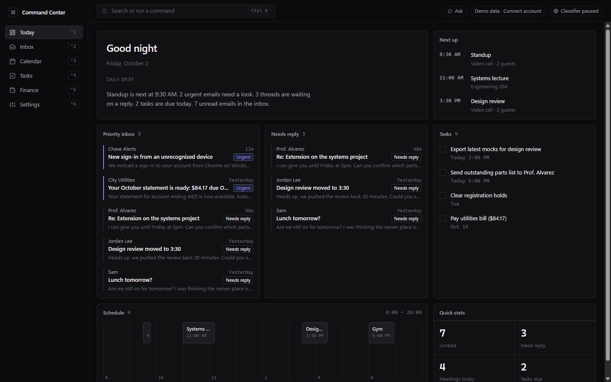
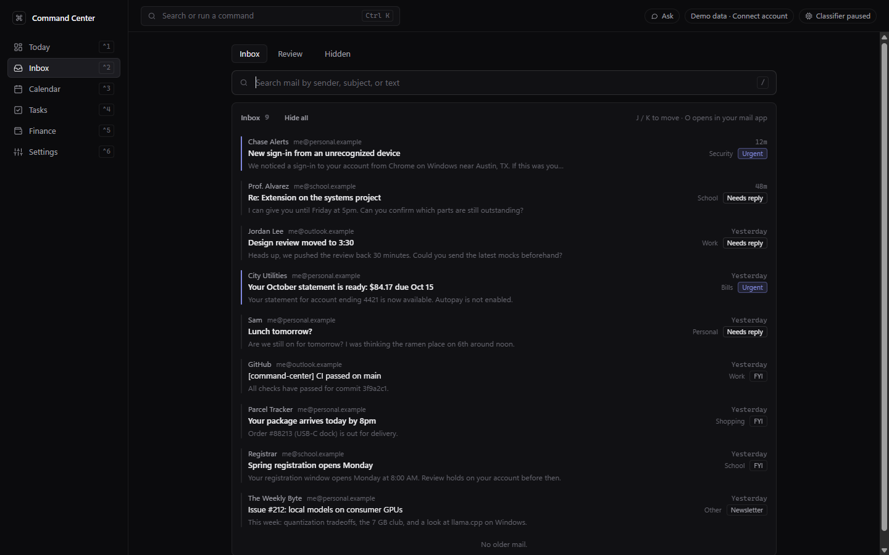
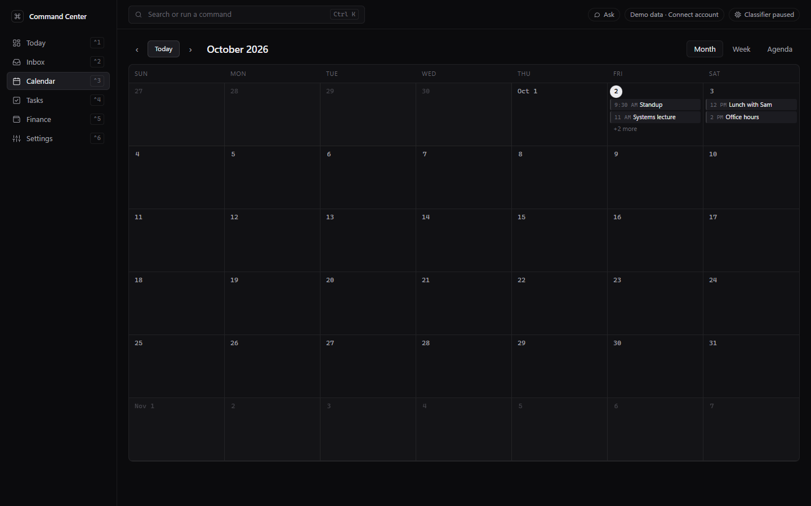
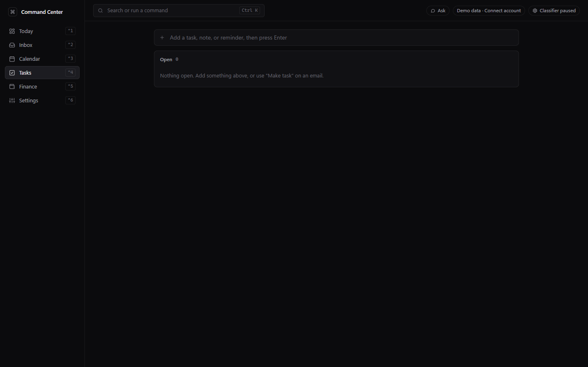
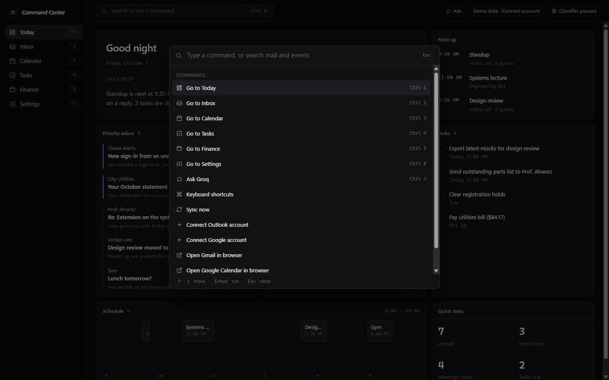

# Command Center

A local-first desktop app that puts mail, calendar, school and money-from-email in one keyboard-first screen. Built with Electron, React, TypeScript and SQLite. Everything is stored on your machine; the only network calls are to your mail providers and the AI APIs you configure.



## What it does

- **Unified inbox** across Outlook (Microsoft Graph), any number of Gmail accounts (Gmail API) and iCloud Mail (IMAP, read-only with an app-specific password). Mail can be hidden locally, one at a time or all at once, without touching the provider.
- **Today screen** that answers "what needs my attention right now": daily brief, priority mail, threads waiting on a reply, next events, tasks, assignments, and a schedule strip. The brief comes either as the built-in summary or as **concrete next steps** written by the assistant, and has a bar underneath for asking follow-up questions about your day without leaving the screen.
- **School assignments from Canvas**, using an access token you create yourself: what is due **today, in the next 7 days, or in the next 30 days**, with the timeframe switchable on the tile and remembered. Overdue work is kept in its own group, Canvas's own "handed in" and "missing" state is shown, and you can tick an item off locally without touching Canvas.
- **Auto-classification** of new mail by priority, category and "needs reply", using a hosted classifier behind a swappable interface. Low-confidence mail goes to a Review tab and your corrections are stored.
- **Assistant** on the AI provider of your choice — **Claude, ChatGPT, Gemini, Groq or OpenRouter** — to summarize an email, draft a reply, or turn it into a task, only when you press the button. Connect any of them with a key, pick the model, and switch between them at any time; drafts are never sent from the app, and every AI action is logged.
- **Calendar** with month and week views, per-account colours, and de-duplication of events that arrive from several sources.
- **Tasks and reminders**, plus a **Finance** view: bills, subscriptions and receipts pulled out of mail (the scan must quote evidence that money actually moved, so offers and gift-card promos are rejected), one-click adding from bill-like emails, hand-entered account balances, and **API usage** tracking with spend and remaining credit for the AI services.
- **Command palette** (`Ctrl+K`) to search mail and events and run any action. All shortcuts are rebindable.
- **Themes**: six palettes (dark, light, midnight blue, deep forest, light forest, ember) plus a custom one where you pick the base and the accent. Applies instantly and is remembered, including the window's own background colour.
- **Logs** view (`Ctrl+7`) for debugging: failed syncs and sign-ins, buttons whose action failed, uncaught errors and crashes in either process, each with its stack trace. A top-bar alert counts errors you haven't looked at yet, the log survives restarts, and it can be filtered, copied, or opened as a file. It stays on your PC.
- Tray icon, daily database backups, and read-only mail access by default.

| Inbox | Calendar |
|---|---|
|  |  |
| **Tasks** | **Command palette** |
|  |  |

## Security

- Renderer runs sandboxed with context isolation; only a typed API is exposed, and every IPC call is checked to come from the app's own page.
- The window can't navigate away from the app; links open in the default browser. Email bodies render in a script-less sandboxed iframe with remote images off by default.
- Electron fuses disable RunAsNode, Node inspector flags and `NODE_OPTIONS`, and enforce asar integrity.
- Email text given to the assistant is treated as untrusted; it only creates tasks or events when the user asks. The same holds for assignment titles and course names, which come from other people too.
- Access tokens and app passwords (Canvas, iCloud) are encrypted with Windows DPAPI alongside the OAuth refresh tokens, never written to the database, and the Canvas token is only ever sent to the host you entered.

## Architecture

```
Gmail (xN) / Outlook / iCloud (IMAP) / calendars / Canvas
        |  OAuth (loopback), app password or access token + delta sync
        v
 Sync layer (Electron main)  --->  SQLite (node:sqlite, local)
        |                               |
        v                               v
 Classifier (swappable)  ------>  Today / Inbox / search / assignments
        |
        v
 Assistant (on demand: per email, or the day's brief and follow-ups)
```

- **Main process:** OAuth flows, sync workers, SQLite, secrets, scheduled jobs.
- **Renderer:** React UI only, talking to main through a typed IPC bridge.
- **Adapters per provider** (connect, sync, search), so adding a source doesn't touch core code.
- **Secrets** are encrypted with Windows DPAPI and never stored in the database or in git.

More detail and the reasoning behind each choice is in [docs/DESIGN.md](docs/DESIGN.md).

## Running it

Requires Node 22+ and Windows (secret storage uses DPAPI). The app starts with seeded demo data, which is what the screenshots show.

```bash
cd app
npm install
npm run dev
```

To connect real accounts you need your own OAuth clients, because this project is not verified by Google or Microsoft:

- **Google:** create a Desktop OAuth client with the Gmail and Calendar APIs enabled and save it as `client_secret_google.json` in the project root (it is gitignored). Press **Add Google account** in Settings once per Gmail address; each one syncs on its own and shows up in the sidebar's account switcher. While the OAuth app is in testing mode, add every address you want to connect under **OAuth consent screen → Test users**, or Google blocks the sign-in.
- **Microsoft:** register an Azure app for Microsoft Graph and set `MS_CLIENT_ID` to its client ID.
- **Classifier:** paste a TypeSafe key in Settings.
- **Assistant:** in Settings → Assistant, press Connect on Claude, ChatGPT, Gemini, Groq or OpenRouter. That opens the provider's API-keys page in your browser; sign in, create a key, and paste it back. Keys are checked before they are stored, and the model list comes from the provider, so it stays current as models ship. Note that a Claude Pro, ChatGPT Plus or Gemini Advanced subscription does **not** cover API use — none of these providers exposes an OAuth flow a third-party desktop app can use, so programmatic calls are billed per token on a separate API account.

Canvas needs nothing registered: in Canvas go to **Account → Settings → + New Access Token**, then
paste the token and your school's Canvas address (for example `school.instructure.com`) into
Settings → School. The token is read-only in practice, since Command Center only ever reads your
courses and what is due. Treat it like a password: it can do anything your Canvas account can, so
delete it in Canvas if you lose the machine.

## Installing it

`npm run dev` is for working on the app. To get something you can just click:

```bash
cd app
npm run build:win
```

That writes two files to `app/dist/`:

| File | What it does |
|---|---|
| `command-center-1.0.0-setup.exe` | One-click installer. No admin prompt (it installs per user), adds a desktop shortcut and a Start menu entry, and opens the app when it finishes. Settings → App can then start it with Windows. |
| `command-center-1.0.0-portable.exe` | The whole app in one file. Copy it anywhere, double-click, nothing to install. |

Either way it is an ordinary Windows app: no terminal, no Node, and closing the window leaves it
running in the tray so sync and reminders carry on. Both are unsigned, so SmartScreen shows
"Windows protected your PC" the first time — **More info → Run anyway**. Signing it would need a
code-signing certificate, which this project doesn't have.

Set `CC_USER_DATA` to use a separate data folder, for example when trying the demo without touching real data.

## Status

A personal project I built for myself, in under 24 hours. It packages into a normal Windows app (see Installing it), but it is not code-signed or published anywhere.

## License

MIT. See [LICENSE](LICENSE).
